<div align="center">


**Brixton Pham** · vibe builder from Vietnam

I describe it, AI builds it, I ship it, and then a system keeps it running.

</div>

## 🔭 What I do

- 🧑‍💻 **Vibe coding**: whole products, from the first prompt to production, payments included
- 🎨 **Vibe design**: landing pages, UI and brand assets made with AI
- 📣 **Vibe marketing**: content, short video and social posts at volume
- ⚙️ **Automatic systems**: scheduled agents that post, report and fix things on their own

## 🧩 Open source

**[muse2api-cli](https://github.com/brixtonpham/muse2api-cli)**: an unofficial Python library and command line for [Muse](https://muse.ai). Give it a prompt and reference images; it generates the videos and images and saves them to disk, by driving the muse.ai web app in your own logged-in browser.


```bash
pip install git+https://github.com/brixtonpham/muse2api-cli
muse2api login --account main --browser
muse2api gen --prompt "a 10 s video of a cat surfing" --ref cat.jpg --out out/
```

## 🛠 Stack


## 🐍 Activity

<picture>
  <source media="(prefers-color-scheme: dark)" srcset="./profile-3d-contrib/profile-night-rainbow.svg" />
  
</picture>

<picture>
  <source media="(prefers-color-scheme: dark)" srcset="https://raw.githubusercontent.com/brixtonpham/brixtonpham/output/snake-dark.svg" />
  
</picture>

<sub>Both graphs redraw themselves every night, from a scheduled workflow in this repo.</sub>

<p align="center"><b>Ship first, polish later.</b></p>
