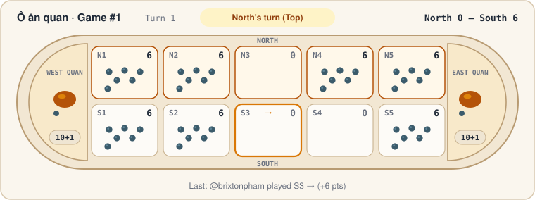

<div align="center">


**Brixton Pham** · Vietnam

*Vibe coding gets you to launch. Automated maintenance keeps it alive.*

I build small software products end to end, wire up agents to monitor and patch them after launch, and contribute fixes upstream to open-source agent tools.

</div>

## 🔭 What I do

- 🛠️ **End-to-end products**: taking ideas from first prototype to live production — small stacks, real users, low ops overhead
- 🔁 **Autonomous maintenance & agents**: Claude Code skills, MCP servers, browser automation, and scheduled agents that monitor, report, and fix things after launch
- 🎬 **AI media & content pipelines**: automated short-video, asset, and publishing workflows built for volume
- 🔧 **Open source**: fixing bugs and shipping improvements across agent sandboxes, dev tools, and local AI runtimes

## 🧩 Open source

**[muse2api-cli](https://github.com/brixtonpham/muse2api-cli)**: an unofficial Python library and command line for [Muse](https://muse.ai). Give it a prompt and reference images; it generates the videos and images and saves them to disk, by driving the muse.ai web app in your own logged-in browser.


```bash
pip install git+https://github.com/brixtonpham/muse2api-cli
muse2api login --account main --browser
muse2api gen --prompt "a 10 s video of a cat surfing" --ref cat.jpg --out out/
```

**[timkeypro-skills](https://github.com/brixtonpham/timkeypro-skills)**: free local-first video skills for Claude Code — clone any video's edit style into a CapCut draft, generate Vietnamese sales scripts, repurpose one video across platforms, score 5-second hooks, and run pre-upload authenticity checks.

### 🔧 Recent open-source work

<!-- OSS-WORK:START -->
Merged upstream PRs: **4** across **4** repositories ([live search](https://github.com/pulls?q=is%3Apr+author%3Abrixtonpham+is%3Amerged+-user%3Abrixtonpham)). Open pull requests are proposals, not merged features.

- 🟣 merged — **[rlaope/oh-my-hermes#3210](https://github.com/rlaope/oh-my-hermes/pull/3210)** fix(fanout): bound verification and reproduction commands in UTF-8 bytes
- 🟣 merged — **[erkamyaman/safe-anything#76](https://github.com/erkamyaman/safe-anything/pull/76)** fix(agent): check permissions.allow for agent.unrestricted-shell
- 🟣 merged — **[opensandbox-group/OpenSandbox#3069](https://github.com/opensandbox-group/OpenSandbox/pull/3069)** fix(egress): base credential-bound mode checks on session configuration
- 🟣 merged — **[erkamyaman/rust-anything#395](https://github.com/erkamyaman/rust-anything/pull/395)** fix(http): fail when fixed port is already in use or build exits before listening
- 🟢 open — **[skyhook-io/radar#2846](https://github.com/skyhook-io/radar/pull/2846)** feat(relations): add CSI VolumeSnapshot resource relationships

<details>
<summary>Full history (4 merged · 12 in review)</summary>

**Merged (4)**

- 🟣 merged — **[rlaope/oh-my-hermes#3210](https://github.com/rlaope/oh-my-hermes/pull/3210)** fix(fanout): bound verification and reproduction commands in UTF-8 bytes
- 🟣 merged — **[erkamyaman/safe-anything#76](https://github.com/erkamyaman/safe-anything/pull/76)** fix(agent): check permissions.allow for agent.unrestricted-shell
- 🟣 merged — **[opensandbox-group/OpenSandbox#3069](https://github.com/opensandbox-group/OpenSandbox/pull/3069)** fix(egress): base credential-bound mode checks on session configuration
- 🟣 merged — **[erkamyaman/rust-anything#395](https://github.com/erkamyaman/rust-anything/pull/395)** fix(http): fail when fixed port is already in use or build exits before listening

**In review (12)**

- 🟢 open — **[skyhook-io/radar#2846](https://github.com/skyhook-io/radar/pull/2846)** feat(relations): add CSI VolumeSnapshot resource relationships
- 🟢 open — **[eugenioenko/ttt#1724](https://github.com/eugenioenko/ttt/pull/1724)** fix(git): diff merge commits against first parent in commit details
- 🟢 open — **[storytold/craft-common-actions#365](https://github.com/storytold/craft-common-actions/pull/365)** agent-roots-conformance: add shared Rule 18 startup confinement check
- 🟢 open — **[storytold/craft-contrib#90](https://github.com/storytold/craft-contrib/pull/90)** RFC-0090: Rule 18 covers connected agent entry points and adds a shared conformance check
- 🟢 open — **[storytold/craft-launcher#1631](https://github.com/storytold/craft-launcher/pull/1631)** fix(macos): unregister staging path and register installed app with LaunchServices
- 🟢 open — **[storytold/craft-libs#3457](https://github.com/storytold/craft-libs/pull/3457)** fix(color-ui): report one SwatchPalette pick per click on release
- 🟢 open — **[storytold/figcraft#2625](https://github.com/storytold/figcraft/pull/2625)** fix(collab-net): stop wildcard hosts without a loopback self-connect
- 🟢 open — **[tangency-labs/solidcraft#21525](https://github.com/tangency-labs/solidcraft/pull/21525)** Frames: move turn_to_parallel and tapered_flange_ends across solidcore layers (#21397)
- 🟢 open — **[BaaRai/ARTEX#533](https://github.com/BaaRai/ARTEX/pull/533)** chore: migrate log.Printf to log/slog in agent and cmd
- 🟢 open — **[nexu-io/openmotion#765](https://github.com/nexu-io/openmotion/pull/765)** fix(dsh): recover when --dump-config rejects Electron-managed desktop profile
- 🟢 open — **[MODSetter/SurfSense#2466](https://github.com/MODSetter/SurfSense/pull/2466)** fix(local): remove unread template.system_role and llama.cpp run.args from manifest
- 🟢 open — **[ag-ui-protocol/ag-ui#3431](https://github.com/ag-ui-protocol/ag-ui/pull/3431)** fix(langgraph): stream content carried on finish_reason chunks

</details>

<sub>Updated automatically daily from public GitHub activity.</sub>
<!-- OSS-WORK:END -->

## 🏮 Play Ô ăn quan (Vietnamese Mandarin Square Capturing)

<!-- OANQUAN:START -->
<div align="center">

<picture>
  <source media="(prefers-color-scheme: dark)" srcset="https://raw.githubusercontent.com/brixtonpham/brixtonpham/game-state/board-dark.svg?v=g1-t1" />
  
</picture>

**North's turn (top row)** — click a pit & direction, then press **Create** on the prefilled issue:

| N1 (6) | N2 (6) | N3 (0) | N4 (6) | N5 (6) |
| :---: | :---: | :---: | :---: | :---: |
| [←](https://github.com/brixtonpham/brixtonpham/issues/new?title=oanquan%7Cg1%7Ct1%7CN1%7CL&body=Click%20Create%20to%20sow%20N1%20left.%20No%20edit%20needed.) · [→](https://github.com/brixtonpham/brixtonpham/issues/new?title=oanquan%7Cg1%7Ct1%7CN1%7CR&body=Click%20Create%20to%20sow%20N1%20right.%20No%20edit%20needed.) | [←](https://github.com/brixtonpham/brixtonpham/issues/new?title=oanquan%7Cg1%7Ct1%7CN2%7CL&body=Click%20Create%20to%20sow%20N2%20left.%20No%20edit%20needed.) · [→](https://github.com/brixtonpham/brixtonpham/issues/new?title=oanquan%7Cg1%7Ct1%7CN2%7CR&body=Click%20Create%20to%20sow%20N2%20right.%20No%20edit%20needed.) | *empty* | [←](https://github.com/brixtonpham/brixtonpham/issues/new?title=oanquan%7Cg1%7Ct1%7CN4%7CL&body=Click%20Create%20to%20sow%20N4%20left.%20No%20edit%20needed.) · [→](https://github.com/brixtonpham/brixtonpham/issues/new?title=oanquan%7Cg1%7Ct1%7CN4%7CR&body=Click%20Create%20to%20sow%20N4%20right.%20No%20edit%20needed.) | [←](https://github.com/brixtonpham/brixtonpham/issues/new?title=oanquan%7Cg1%7Ct1%7CN5%7CL&body=Click%20Create%20to%20sow%20N5%20left.%20No%20edit%20needed.) · [→](https://github.com/brixtonpham/brixtonpham/issues/new?title=oanquan%7Cg1%7Ct1%7CN5%7CR&body=Click%20Create%20to%20sow%20N5%20right.%20No%20edit%20needed.) |

</div>

<details>
<summary>How to play (3 lines) · Recent moves · Top players</summary>

1. Pick one of the active side's 5 pits (`←` left or `→` right) to drop 1 stone per pit around the ring.
2. Land before a non-empty *dân* pit to keep sowing; land before an empty pit followed by a full pit to **capture** it (chain captures allowed; non-empty **Quan** stops sowing).
3. Game ends when both big **Quan** bowls (10 pts each) are empty. Remaining *dân* go to their owner's side; highest score wins.

**Last 5 moves**

| Turn | Player | Side | Move | Captured |
| ---: | :--- | :--- | :---: | ---: |
| 1 | [@brixtonpham](https://github.com/brixtonpham) | South | `S3 →` | +6 |

**Top players**

| Player | Moves | Captured | Wins |
| :--- | ---: | ---: | ---: |
| [@brixtonpham](https://github.com/brixtonpham) | 1 | 6 | 0 |

</details>
<!-- OANQUAN:END -->

## 🛠 Stack


## 🐍 Activity

<picture>
  <source media="(prefers-color-scheme: dark)" srcset="https://raw.githubusercontent.com/brixtonpham/brixtonpham/output/snake-dark.svg" />
  
</picture>

<sub>Redrawn automatically every night from a scheduled workflow in this repo.</sub>

<p align="center"><sub>Say hi by opening an issue on any repo — or make the next move in Ô ăn quan above.</sub></p>
