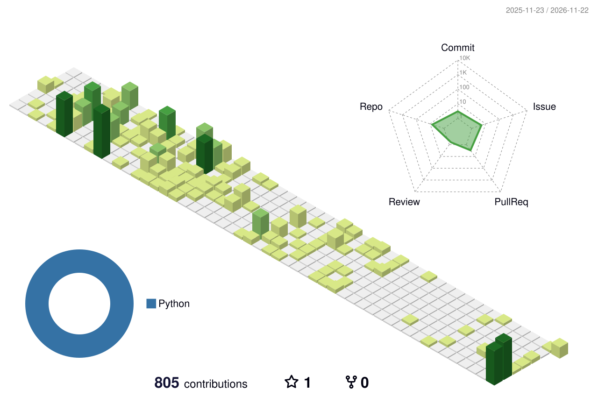

<div align="center">


**Brixton Pham** · vibe builder from Vietnam

I describe it, AI builds it, I ship it, and then a system keeps it running.

</div>

## 🔭 What I do

- 🧑‍💻 **Vibe coding**: whole products, from the first prompt to production, payments included
- 🎨 **Vibe design**: landing pages, UI and brand assets made with AI
- 📣 **Vibe marketing**: content, short video and social posts at volume
- ⚙️ **Automatic systems**: scheduled agents that post, report and fix things on their own

## 🧩 Open source

**[muse2api-cli](https://github.com/brixtonpham/muse2api-cli)**: an unofficial Python library and command line for [Muse](https://muse.ai). Give it a prompt and reference images; it generates the videos and images and saves them to disk, by driving the muse.ai web app in your own logged-in browser.


```bash
pip install git+https://github.com/brixtonpham/muse2api-cli
muse2api login --account main --browser
muse2api gen --prompt "a 10 s video of a cat surfing" --ref cat.jpg --out out/
```

### 🔧 Recent open-source work

<!-- OSS-WORK:START -->
- 🟢 open — **[skyhook-io/radar#2846](https://github.com/skyhook-io/radar/pull/2846)** feat(relations): add CSI VolumeSnapshot resource relationships
- 🟢 open — **[simplexai-labs/linger#400](https://github.com/simplexai-labs/linger/pull/400)** fix(web): disambiguate duplicate runtime model display labels
- 🟢 open — **[ag-ui-protocol/ag-ui#3431](https://github.com/ag-ui-protocol/ag-ui/pull/3431)** fix(langgraph): stream content carried on finish_reason chunks
- 🟢 open — **[nexu-io/openmotion#765](https://github.com/nexu-io/openmotion/pull/765)** fix(dsh): recover when --dump-config rejects Electron-managed desktop profile

<sub>Updated automatically daily from public GitHub activity.</sub>
<!-- OSS-WORK:END -->

## 🏮 Play Ô ăn quan (Vietnamese Mandarin Square Capturing)

<!-- OANQUAN:START -->
<div align="center">

<picture>
  <source media="(prefers-color-scheme: dark)" srcset="https://raw.githubusercontent.com/brixtonpham/brixtonpham/game-state/board-dark.svg?v=g1-t1" />
  
</picture>

**North's turn (top row)** — click a pit & direction, then press **Create** on the prefilled issue:

| N1 (6) | N2 (6) | N3 (0) | N4 (6) | N5 (6) |
| :---: | :---: | :---: | :---: | :---: |
| [←](https://github.com/brixtonpham/brixtonpham/issues/new?title=oanquan%7Cg1%7Ct1%7CN1%7CL&body=Click%20Create%20to%20sow%20N1%20left.%20No%20edit%20needed.) · [→](https://github.com/brixtonpham/brixtonpham/issues/new?title=oanquan%7Cg1%7Ct1%7CN1%7CR&body=Click%20Create%20to%20sow%20N1%20right.%20No%20edit%20needed.) | [←](https://github.com/brixtonpham/brixtonpham/issues/new?title=oanquan%7Cg1%7Ct1%7CN2%7CL&body=Click%20Create%20to%20sow%20N2%20left.%20No%20edit%20needed.) · [→](https://github.com/brixtonpham/brixtonpham/issues/new?title=oanquan%7Cg1%7Ct1%7CN2%7CR&body=Click%20Create%20to%20sow%20N2%20right.%20No%20edit%20needed.) | *empty* | [←](https://github.com/brixtonpham/brixtonpham/issues/new?title=oanquan%7Cg1%7Ct1%7CN4%7CL&body=Click%20Create%20to%20sow%20N4%20left.%20No%20edit%20needed.) · [→](https://github.com/brixtonpham/brixtonpham/issues/new?title=oanquan%7Cg1%7Ct1%7CN4%7CR&body=Click%20Create%20to%20sow%20N4%20right.%20No%20edit%20needed.) | [←](https://github.com/brixtonpham/brixtonpham/issues/new?title=oanquan%7Cg1%7Ct1%7CN5%7CL&body=Click%20Create%20to%20sow%20N5%20left.%20No%20edit%20needed.) · [→](https://github.com/brixtonpham/brixtonpham/issues/new?title=oanquan%7Cg1%7Ct1%7CN5%7CR&body=Click%20Create%20to%20sow%20N5%20right.%20No%20edit%20needed.) |

</div>

<details>
<summary>How to play (3 lines) · Recent moves · Top players</summary>

1. Pick one of the active side's 5 pits (`←` left or `→` right) to drop 1 stone per pit around the ring.
2. Land before a non-empty *dân* pit to keep sowing; land before an empty pit followed by a full pit to **capture** it (chain captures allowed; non-empty **Quan** stops sowing).
3. Game ends when both big **Quan** bowls (10 pts each) are empty. Remaining *dân* go to their owner's side; highest score wins.

**Last 5 moves**

| Turn | Player | Side | Move | Captured |
| ---: | :--- | :--- | :---: | ---: |
| 1 | [@brixtonpham](https://github.com/brixtonpham) | South | `S3 →` | +6 |

**Top players**

| Player | Moves | Captured | Wins |
| :--- | ---: | ---: | ---: |
| [@brixtonpham](https://github.com/brixtonpham) | 1 | 6 | 0 |

</details>
<!-- OANQUAN:END -->

## 🛠 Stack


## 🐍 Activity

<picture>
  <source media="(prefers-color-scheme: dark)" srcset="./profile-3d-contrib/profile-night-rainbow.svg" />
  
</picture>

<picture>
  <source media="(prefers-color-scheme: dark)" srcset="https://raw.githubusercontent.com/brixtonpham/brixtonpham/output/snake-dark.svg" />
  
</picture>

<sub>Both graphs redraw themselves every night, from a scheduled workflow in this repo.</sub>

<p align="center"><b>Ship first, polish later.</b></p>
